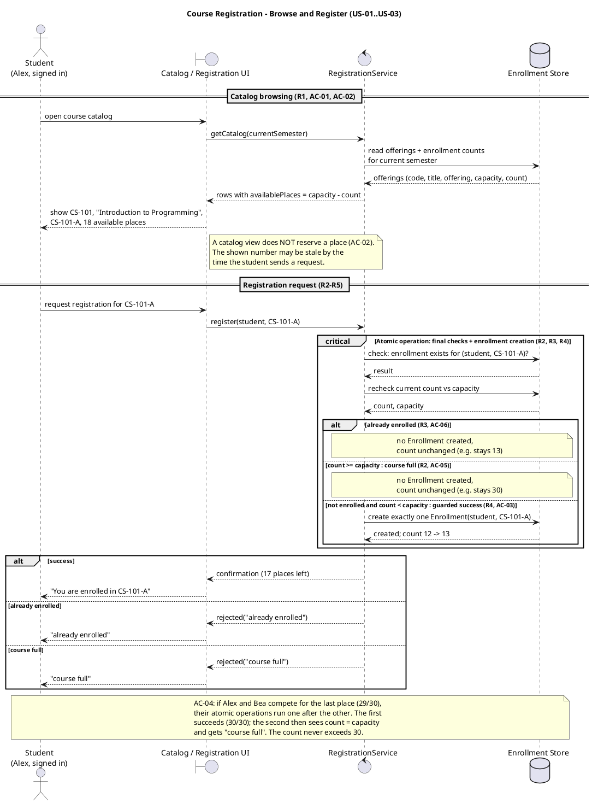
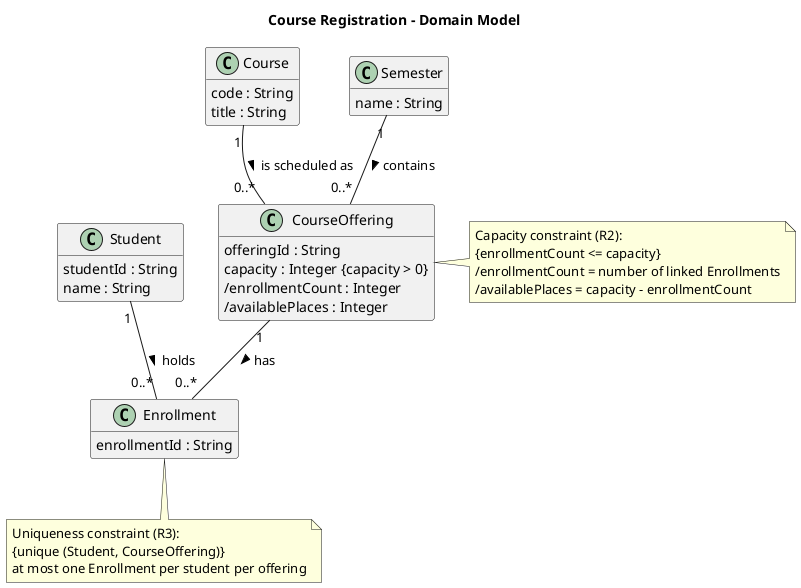
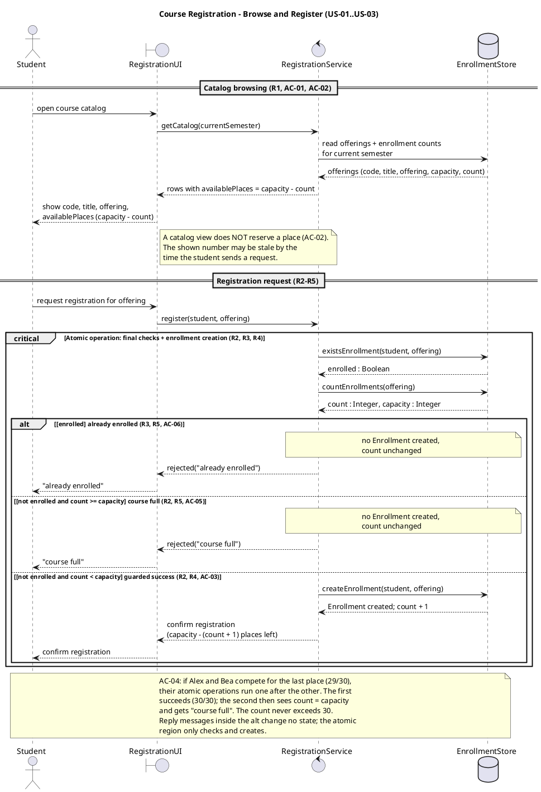
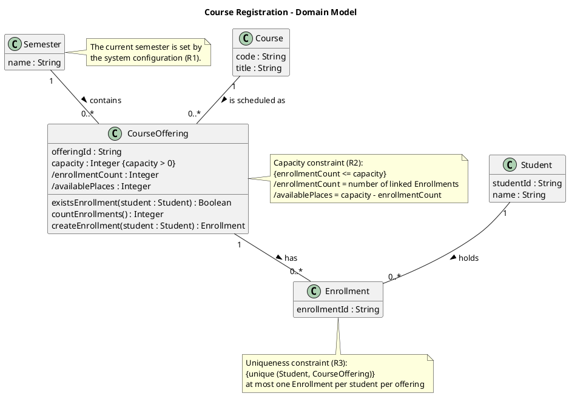

# SIS #02 — AI-Assisted UML Modeling: University Course Registration

<!--
  This is the only file you write your report in. README.md tells you what goes where.

  Rules the checker relies on:
  - Do not delete, rename or renumber the ## headings, the ### headings, or the **Label:** words.
  - Replace every "(write here)" and "(paste here)". None may be left when you submit.
  - Comments like this one are ignored by the checker and the word counter. Delete them or leave them.
-->

## 1. Scope and assumptions

<!-- Your FINAL scope statement and assumptions, after reviewing Prompt A's output. Say here
     what is out of scope (payments, prerequisites, timetable clashes, waiting lists,
     cancellation) — section 2 must not mention them. Section 10 keeps your first version. -->

**Scope:** The system lets a signed-in student browse the course catalog for the current semester, choose a course offering and register for it. The system accepts or rejects the request and explains why. Payments, prerequisites, timetable clashes, waiting lists and cancellation are out of scope.

**Assumptions:**

1. The catalog shows only the current semester.
2. Available places = capacity minus the number of enrollments in the offering.
3. A catalog view reserves nothing. The system checks the places again when the student registers.
4. The duplicate check, the capacity check and the creation of the Enrollment are one atomic step, so two requests can not take the same last place.
5. If a student is already enrolled and the offering is also full, the system answers "already enrolled", because the duplicate check comes first.
6. All students and courses are fictional.

## 2. User stories and acceptance criteria

<!-- Your APPROVED requirements: Prompt A's draft after your review. Keep the IDs, the three
     story headings and the bullet shape. Every criterion names the rule(s) it maps to,
     e.g. (R2, R4). Two criteria per story. Nothing out of scope.
     Format of a criterion, on one bullet:
     - **AC-03** (R2, R4): Given ..., When ..., Then ... -->

### US-01 — Browse offerings

**US-01:** As a signed-in student, I want to see the course offerings of the current semester with their available places, so that I can choose an offering to register for.

- **AC-01** (R1): Given offering CS-101-A of course CS-101 "Introduction to Programming" in the current semester has capacity 30 and 12 enrollments, When Alex opens the course catalog, Then the catalog shows the code CS-101, the title "Introduction to Programming", the offering CS-101-A and 18 available places, and only offerings of that semester.
- **AC-02** (R1, R2): Given the catalog showed Alex 1 available place in CS-101-A, When Bea registers for CS-101-A before Alex sends a request, Then no place is held for Alex, and when Alex then requests registration the system checks the places again at that moment.

### US-02 — Register for an offering

**US-02:** As a signed-in student, I want to request registration for an offering I chose, so that I am enrolled and get a confirmation.

- **AC-03** (R2, R3, R4): Given CS-101-A has capacity 30 and 12 enrollments and Alex has no enrollment in it, When Alex requests registration for CS-101-A, Then the system checks again, creates exactly one Enrollment linking Alex and CS-101-A, the count becomes 13 with 17 places left, and Alex gets a confirmation.
- **AC-04** (R2, R4, R5): Given CS-101-A has capacity 30 and 29 enrollments and neither Alex nor Bea is enrolled in it, When Alex and Bea request registration at the same time, Then exactly one of them gets an Enrollment and a confirmation, the other is rejected with "course full", and the count ends at 30, never more.

### US-03 — Receive a clear rejection

**US-03:** As a signed-in student, I want to be told why my registration request was rejected, so that I know I was not enrolled.

- **AC-05** (R2, R5): Given CS-101-A has capacity 30 and 30 enrollments and Chen has no enrollment in it, When Chen requests registration for CS-101-A, Then the request is rejected with "course full", no Enrollment is created and the count stays 30.
- **AC-06** (R3, R5): Given Alex already has an Enrollment in CS-101-A and it has 13 enrollments, When Alex requests registration for CS-101-A again, Then the request is rejected with "already enrolled", no new Enrollment is created and the count stays 13.

## 3. Sequence diagram

<!-- The FINAL diagram, rendered. Change .png to .svg if that is what you exported. -->


**Participants:** Student is the signed-in student. RegistrationUI is the screen with the catalog and the register button. RegistrationService runs the rules and the atomic step. EnrollmentStore keeps the offerings and the enrollments.

**Atomic operation:** The critical block holds existsEnrollment(student, offering), countEnrollments(offering) and, only in the success branch, createEnrollment(student, offering). These checks run again after the register request, so the count the student saw in the catalog is not used. A catalog view only reads data, so it reserves nothing. Two requests for the last place go through the critical block one after the other, so only one can pass.

**Where the Enrollment is created:** The message createEnrollment(student, offering) from RegistrationService to EnrollmentStore, in the branch not enrolled and places left. It makes one object of the class Enrollment in section 4, linked to one Student and one CourseOffering.

**Technical lifelines:** RegistrationUI, RegistrationService and EnrollmentStore are not classes in the class diagram. The class diagram shows only domain concepts, and these three are technical parts that show who sends which message. This is fine, because the sequence diagram shows the behaviour and the class diagram shows the data.

## 4. Class diagram

<!-- The FINAL diagram, rendered. -->


<!-- One row per association in classes.puml, read in both directions. -->

| Association | Read left to right | Read right to left |
| --- | --- | --- |
| Course "1" -- "0..*" CourseOffering | One Course is scheduled as zero or more CourseOfferings. | Each CourseOffering belongs to exactly one Course. |
| Student "1" -- "0..*" Enrollment | One Student holds zero or more Enrollments. | Each Enrollment belongs to exactly one Student. |
| CourseOffering "1" -- "0..*" Enrollment | One CourseOffering has zero or more Enrollments. | Each Enrollment is for exactly one CourseOffering. |

**How an Enrollment links a student to an offering:** An Enrollment has two links with multiplicity 1: one to a Student and one to a CourseOffering. So one Enrollment always means "this student is in this offering". The number of Enrollments of an offering is its enrollmentCount.

**Capacity constraint:** enrollmentCount <= capacity for every CourseOffering (note on CourseOffering, R2). A multiplicity like 0..* can not use the value of the capacity attribute, and capacity is different for every offering, so a note is needed.

**Uniqueness constraint:** at most one Enrollment for the same Student and CourseOffering pair (note on Enrollment, R3). The multiplicities say a student can have many Enrollments and an offering can have many Enrollments, but they can not say the pair must be different, so a note is needed.

## 5. Traceability

<!-- Every rule, including the catalog fields and availability (R1). Column 1: the rule and
     the criteria that cover it, e.g. "R2 + AC-03, AC-04". Column 2: the message, guard,
     class or constraint that shows the rule in YOUR diagrams. Column 3: the T-ID that
     exercises it, or the extra check you did instead (R1 has no T case). -->

| Rule and criterion | Model evidence | Validation case |
| --- | --- | --- |
| R1 + AC-01, AC-02 | Messages getCatalog(currentSemester) and show code, title, offering, availablePlaces (capacity - count); attributes Course.code, Course.title, CourseOffering.semester; note on the current semester | No T case. Extra check: I read the catalog messages and they show all four fields of R1 and only the current semester. |
| R2 + AC-02, AC-03, AC-04, AC-05 | countEnrollments(offering) inside the critical block; guard course full and not enrolled; capacity note on CourseOffering | T2, T3 |
| R3 + AC-03, AC-06 | existsEnrollment(student, offering) inside the critical block; guard already enrolled; uniqueness note on Enrollment | T4 |
| R4 + AC-03, AC-04 | createEnrollment(student, offering), then confirm registration, in the branch not enrolled and places left | T1, T2 |
| R5 + AC-04, AC-05, AC-06 | rejected("course full") and rejected("already enrolled"); note no new record, count unchanged in both rejection branches | T3, T4 |

## 6. Walkthroughs

<!-- Walk each case through YOUR final sequence diagram, message by message. Column 2: the
     actual steps and the state change (count before → after). Column 3 starts with Pass or
     Fail, then the location: the message, guard or note where you saw it. A Fail you
     report honestly is a finding, not a penalty. -->

| Case | Observed path and state change | Judgment and evidence |
| --- | --- | --- |
| T1. Available | Student sends request registration for offering, then register(student, offering). In critical: existsEnrollment returns enrolled = false, countEnrollments returns count 0 and capacity 2. Guard not enrolled and places left is true, createEnrollment runs, the store answers Enrollment created; count + 1, then confirm registration goes to the student. Count 0 to 1. | Pass. Seen at createEnrollment(student, offering) and confirm registration in the branch not enrolled and places left. |
| T2. Last place | Same path as T1. existsEnrollment returns false, countEnrollments returns count 1 and capacity 2. 1 < 2, so the guard not enrolled and places left is true, createEnrollment runs and confirm registration says capacity - (count + 1) = 0 places left. Count 1 to 2. | Pass. Seen at the guard not enrolled and places left and the reply confirm registration (capacity - (count + 1) places left). |
| T3. Full | The catalog showed one place, but now the count is 2 of 2. The request goes into critical. existsEnrollment returns false, countEnrollments returns count 2 and capacity 2. The guard course full and not enrolled is true. The note says no new record, then rejected("course full") goes to the student. No createEnrollment message. Count stays 2. | Pass. Seen at countEnrollments(offering) after the request and the guard course full and not enrolled. |
| T4. Duplicate | The same student sends the request again. In critical, existsEnrollment returns enrolled = true. The guard already enrolled is the first branch, so it is true. The note says no new record, then rejected("already enrolled") goes to the student. No createEnrollment message. Count stays 1. | Pass. Seen at existsEnrollment(student, offering) and the guard already enrolled. |

## 7. Review decisions

<!-- At least three substantive decisions about Prompt C's critique or your own inspection.
     Decision: accepted / rejected / modified — and what you did. Reason: why, in a full
     sentence. Rule: R1–R5. Do not invent an error to fill the table; a justified rejection
     of advice counts. -->

| AI suggestion or model element | Decision | Reason | Rule |
| --- | --- | --- | --- |
| Prompt C D1: the guards already enrolled and count >= capacity can both be true | Accepted. The guards are now already enrolled, course full and not enrolled, and not enrolled and places left. | For an enrolled student in a full course the old model did not say which answer comes, and now only one branch can be true. | R3, R5 |
| Prompt C D2: the second alt after critical is not linked to the result | Modified. I asked to put every reply inside its own branch of the one alt, not to add a result variable. | With one alt the reply can never disagree with the branch that really ran, and the replies change no state. | R4, R5 |
| Prompt C D3: numbers from AC-03 (count 12 -> 13, 17 places left) in the shared success branch | Accepted. Now count + 1 and capacity - (count + 1) places left. | In T2 the old text would say 17 places left, but the right answer is 0. | R4 |
| Prompt C D4: show AC-04 with a second par diagram | Rejected. I kept the note on AC-04. | The README says a note about the atomic operation is enough, and a second diagram adds nothing to R1-R5. | R2 |
| Prompt D brackets in guards like [enrolled] | Modified by me. I removed the square brackets from the three guards. | The README says square brackets in alt guards become broken links, because PlantUML adds them itself. | R3, R5 |
| Prompt D operations existsEnrollment, countEnrollments, createEnrollment on CourseOffering | Rejected by me. I removed them from the class diagram and kept hide methods. | These messages go to EnrollmentStore, a technical lifeline, so putting them on CourseOffering gave two owners for the same operation. | R2, R3 |
| Class Semester in the original and in Prompt D | Modified by me. I removed the class and added semester : String to CourseOffering, with a note on the current semester. | R1 only needs the semester of each offering, and the README asks for a semester attribute on CourseOffering. | R1 |

## 8. Modeling explanation

<!-- 200–300 words. Your main design choices; how the class diagram and the sequence diagram
     complement each other; why an activity diagram could also help explain the workflow. -->

My main design choice is one critical block for the final checks and the creation. Inside it, existsEnrollment comes first, then countEnrollments, and only then createEnrollment in the success branch. So the count that the student saw in the catalog is never used for the decision, and two students can not take the same last place. The duplicate check comes first, so a student who is already enrolled in a full course gets "already enrolled".

The second choice is one alt with three guards that can not be true at the same time, and every reply is inside its own branch. A rejection branch only returns a reason and has no create or update message, so R5 is easy to see.

In the class diagram I kept only the four required classes. The semester is an attribute of CourseOffering, because R1 only needs it to filter the catalog. Enrollment has two links with multiplicity 1, so it always joins one student and one offering. The capacity and uniqueness rules are notes, because a multiplicity can not compare a count with a capacity or say that a pair must be unique.

The two diagrams help each other. The class diagram says what data exists and what must always be true. The sequence diagram says in which order the system checks this data and when the Enrollment appears. RegistrationUI, RegistrationService and EnrollmentStore are only in the sequence diagram, because they are technical parts, not domain concepts.

An activity diagram could also help, because the registration is one flow with two decisions: already enrolled, and places left. It shows the three end results side by side without the lifelines, so a reader who does not know UML messages can follow it more easily.

## 9. Reflection

<!-- 150–200 words. Written by you, not by the assistant: where AI helped, one decision you
     made yourself, one remaining limitation. Specific beats flattering. -->

The AI helped most in the critique. The new chat found that the guards already enrolled and count >= capacity could both be true, and that the success branch had numbers from AC-03, which give a wrong answer in T2. I did not see these problems when I first read the diagram, because the main flow looked right.

One decision I made myself was to remove the Semester class. The AI added it in Prompt B and kept it in Prompt D, but R1 only needs to know the semester of each offering. A semester attribute on CourseOffering is simpler and matches the four classes the task asks for. I also removed the square brackets from the guards that Prompt D wrote, because the README says they break the picture.

One limitation is that the race between two students for the last place is only in a note. The diagram shows one request, and the note says that the critical block lets requests through one at a time. A real test with two requests at the same moment is not part of this work.

## 10. Appendix A — Before AI

<!-- Written BEFORE you run Prompt A, committed and pushed in your first commit, and never
     edited afterwards. This is what you paste into Prompt A as "My initial assumptions". -->

**Scope:** The system lets a signed-in student browse the course catalog for one semester, choose a course offering and register for it. The system accepts or rejects the request and explains why. Payments, prerequisites, timetable clashes, waiting lists and cancellation are out of scope.

**Initial assumptions:**

1. The catalog shows the free places at the moment the student looks. This number can change before the student sends the request, so the system checks the places again when the student registers.
2. If two students ask for the last place at the same time, only one of them gets it. The checks and the creation of the enrollment happen as one step.
3. The catalog shows only one semester, the current one.
4. All students and courses in this work are fictional.

## 11. Appendix B — AI exchanges

<!-- Complete prompts and complete responses, as text — never screenshots. Paste each inside
     the ~~~~ block that follows its label: AI responses contain ``` PlantUML blocks, and
     ~~~~ keeps them from breaking this file. Prompts B and C: the prompt text first, then
     the material it refers to ("below", "these two") pasted under it, in the same block.
     You may add B5, B6 … after B4 if you ran more. -->

### B1 — Requirements (Prompt A)

- **Tool:** Claude (Claude Code)
- **Model:** Claude Opus 5.5
- **Date:** 2026-10-07
- **Purpose:** draft 3 user stories and 6 acceptance criteria

<!-- Model: the exact model with its version, as the tool shows it (e.g. "GPT-5 Thinking",
     "Claude Sonnet 4.5"). If the tool does not show it, write: not displayed
     Date: YYYY-MM-DD -->

**Prompt:**

~~~~text
Act as a requirements analyst. Use only this course registration scenario and rules R1–R5: A student browses an electronic course catalog, chooses a course offering and requests registration. Each offering has a limited number of places. A Course describes a subject. A CourseOffering is one scheduled section in one semester. Registration always targets a specific offering. Assume that the student is signed in, the selected offering exists, and its capacity is a positive whole number. Exclude payments, prerequisites, timetable clashes, waiting lists and cancellation. Use fictional students and courses. R1. Catalog: Show the course code, title, offering and available places for one semester. R2. Capacity: Recheck current availability when registering. Enrollment must never exceed the offering's capacity. R3. Duplicates: A student may have at most one enrollment in the same offering. Reject a repeat request. R4. Success: Create exactly one Enrollment linking the student and offering, update availability and return a confirmation. R5. Rejection: Explain "course full" or "already enrolled". Create no enrollment and leave the enrollment count unchanged. A catalog view does not reserve a place. Model the final checks and enrollment creation as one atomic operation so competing requests cannot take the same last place. My initial assumptions are 1. The catalog shows the free places at the moment the student looks. This number can change before the student sends the request, so the system checks the places again when the student registers. 2. If two students ask for the last place at the same time, only one of them gets it. The checks and the creation of the enrollment happen as one step. 3. The catalog shows only one semester, the current one. 4. All students and courses in this work are fictional.
Draft 3 user stories and 2 Given / When / Then acceptance criteria for each. Use IDs US-01 to US-03 and AC-01 to AC-06. Map each criterion to rule IDs.
Cover normal and rejection behavior. List uncertainty separately. Do not add excluded features or invent university policies.
~~~~

**Response:**

~~~~text
Here are three user stories with two acceptance criteria each. All data is fictional. The example offering is CS-101-A, a section of the course CS-101 "Introduction to Programming", in the current semester. It has a capacity of 30.

---

## User Stories and Acceptance Criteria

### US-01: Browse the course catalog
**As a** signed-in student, **I want to** see the course offerings for the semester with their available places, **so that** I can choose an offering to register for.

**AC-01: Catalog shows the required information** *(R1)*
- **Given** student Alex Rivera is signed in
- **And** offering CS-101-A of course CS-101 "Introduction to Programming" in the current semester has capacity 30 and 12 enrollments
- **When** Alex opens the course catalog
- **Then** the catalog shows the course code "CS-101", the title "Introduction to Programming", the offering "CS-101-A" and 18 available places
- **And** it shows only offerings from that one semester

**AC-02: Viewing the catalog does not reserve a place** *(R1, R2)*
- **Given** Alex is viewing the catalog and CS-101-A shows 1 available place
- **When** student Bea Okafor registers for CS-101-A before Alex sends a request
- **Then** Bea's registration succeeds and Alex gets no reserved or held place
- **And** if Alex then requests registration, the system checks availability again at that moment rather than using the number Alex saw

---

### US-02: Register for an offering with free places
**As a** signed-in student, **I want to** request registration for an offering I chose, **so that** I am enrolled and get a confirmation.

**AC-03: Successful registration** *(R2, R4)*
- **Given** CS-101-A has capacity 30 and 12 enrollments
- **And** Alex has no enrollment in CS-101-A
- **When** Alex requests registration for CS-101-A
- **Then** exactly one Enrollment linking Alex and CS-101-A is created
- **And** CS-101-A now has 13 enrollments and shows 17 available places
- **And** Alex gets a confirmation

**AC-04: Two requests for the last place** *(R2, R4, R5)*
- **Given** CS-101-A has capacity 30 and 29 enrollments
- **And** neither Alex nor Bea is enrolled in CS-101-A
- **When** Alex and Bea request registration for CS-101-A at the same time
- **Then** exactly one of them gets an Enrollment and a confirmation
- **And** the other is rejected with "course full", and no Enrollment is created for them
- **And** CS-101-A ends with exactly 30 enrollments, never more

---

### US-03: Be told clearly why a registration was rejected
**As a** signed-in student, **I want to** be told why my registration request was rejected, **so that** I understand that I was not enrolled.

**AC-05: Rejected because the course is full** *(R2, R5)*
- **Given** CS-101-A has capacity 30 and 30 enrollments
- **And** Chen Larsen has no enrollment in CS-101-A
- **When** Chen requests registration for CS-101-A
- **Then** the request is rejected with the explanation "course full"
- **And** no Enrollment is created
- **And** CS-101-A still has 30 enrollments

**AC-06: Rejected because the student is already enrolled** *(R3, R5)*
- **Given** Alex already has an Enrollment in CS-101-A
- **And** CS-101-A has capacity 30 and 13 enrollments
- **When** Alex requests registration for CS-101-A again
- **Then** the request is rejected with the explanation "already enrolled"
- **And** no new Enrollment is created
- **And** CS-101-A still has 13 enrollments

---

## Rule Coverage

| Rule | Covered by |
|---|---|
| R1 Catalog | AC-01, AC-02 |
| R2 Capacity | AC-02, AC-03, AC-04, AC-05 |
| R3 Duplicates | AC-06 |
| R4 Success | AC-03, AC-04 |
| R5 Rejection | AC-04, AC-05, AC-06 |

Normal behavior is covered by AC-01 and AC-03. Rejections and edge cases are covered by AC-02, AC-04, AC-05 and AC-06.

---

## Uncertainties (open questions, not decided here)

1. **Which semester.** R1 says "one semester". Showing only the current one is your assumption 3, not a rule. Who decides which semester is shown?
2. **What "offering" means on screen.** R1 asks for the offering to be shown, but not which details: a section ID, a schedule, or something else.
3. **Both reasons at once.** If an offering is full and the student is already enrolled in it, which message is shown? The rules don't set an order.
4. **Duplicate requests sent together.** If one student sends two requests for the same offering at the same moment (for example, a double-click), is the duplicate check part of the same single step as the capacity check? The atomic-step note suggests yes, but it isn't stated directly.
5. **What the confirmation contains.** R4 asks for a confirmation but doesn't say what is in it or how it is delivered.
6. **Exact wording of the messages.** R5 gives "course full" and "already enrolled". Are these the exact texts, or only what the message must mean?
7. **How available places are worked out.** I assumed available places = capacity − number of enrollments. The rules imply this but never define it.
8. **Catalog refresh.** Should the catalog update by itself when availability changes, or only when the student reloads it? R1 doesn't say.
9. **Other sections of the same course.** R3 limits a student to one enrollment per offering. The rules don't say whether a student may enroll in two different offerings of the same course. I added no rule for this.
10. **Capacity changes.** The rules don't cover what happens if an offering's capacity changes after students have enrolled.
11. **Meaning of "at the same time".** Assumption 2 says only one student gets the last place. The rules don't say how the winner is chosen, for example the first request to arrive.

Your assumptions 1 and 2 match R2 and the note about the single atomic step. Assumption 4 is followed throughout. Nothing excluded (payments, prerequisites, timetable clashes, waiting lists, cancellation) has been added.
~~~~

### B2 — UML drafts (Prompt B)

- **Tool:** Claude (Claude Code)
- **Model:** Claude Opus 5.5
- **Date:** 2026-10-07
- **Purpose:** draft the sequence and class diagrams

**Prompt:**

~~~~text
Using my approved scenario, R1–R5, stories and criteria below, return separate PlantUML code blocks for a sequence diagram and a domain class diagram.
Sequence: include catalog browsing and guarded success, full-course and duplicate outcomes. Model final checks and creation as one atomic operation.
Class: show domain concepts, useful attributes and multiplicities. State the capacity and uniqueness constraints. Explain assumptions and any technical lifelines.

### US-01 — Browse offerings

**US-01:** As a signed-in student, I want to see the course offerings of the current semester with their available places, so that I can choose an offering to register for.

- **AC-01** (R1): Given offering CS-101-A of course CS-101 "Introduction to Programming" in the current semester has capacity 30 and 12 enrollments, When Alex opens the course catalog, Then the catalog shows the code CS-101, the title "Introduction to Programming", the offering CS-101-A and 18 available places, and only offerings of that semester.
- **AC-02** (R1, R2): Given the catalog showed Alex 1 available place in CS-101-A, When Bea registers for CS-101-A before Alex sends a request, Then no place is held for Alex, and when Alex then requests registration the system checks the places again at that moment.

### US-02 — Register for an offering

**US-02:** As a signed-in student, I want to request registration for an offering I chose, so that I am enrolled and get a confirmation.

- **AC-03** (R2, R3, R4): Given CS-101-A has capacity 30 and 12 enrollments and Alex has no enrollment in it, When Alex requests registration for CS-101-A, Then the system checks again, creates exactly one Enrollment linking Alex and CS-101-A, the count becomes 13 with 17 places left, and Alex gets a confirmation.
- **AC-04** (R2, R4, R5): Given CS-101-A has capacity 30 and 29 enrollments and neither Alex nor Bea is enrolled in it, When Alex and Bea request registration at the same time, Then exactly one of them gets an Enrollment and a confirmation, the other is rejected with "course full", and the count ends at 30, never more.

### US-03 — Receive a clear rejection

**US-03:** As a signed-in student, I want to be told why my registration request was rejected, so that I know I was not enrolled.

- **AC-05** (R2, R5): Given CS-101-A has capacity 30 and 30 enrollments and Chen has no enrollment in it, When Chen requests registration for CS-101-A, Then the request is rejected with "course full", no Enrollment is created and the count stays 30.
- **AC-06** (R3, R5): Given Alex already has an Enrollment in CS-101-A and it has 13 enrollments, When Alex requests registration for CS-101-A again, Then the request is rejected with "already enrolled", no new Enrollment is created and the count stays 13.
~~~~

**Response:**

~~~~text
Here are the two diagrams, built only from your approved scenario, R1–R5, US-01 to US-03 and AC-01 to AC-06. Students and courses are fictional. I have not rendered either diagram, so the code has not been checked in a PlantUML viewer yet.

## 1. Sequence diagram



## 2. Domain class diagram



## Constraints

- **Capacity (R2):** For every CourseOffering, `enrollmentCount <= capacity`, and `capacity` is a positive whole number (scenario assumption). The constraint is enforced by rechecking inside the atomic operation, not by the number shown in the catalog.
- **Uniqueness (R3):** For any pair of Student and CourseOffering, there is at most one Enrollment.
- **Exactly one (R4):** A successful request creates exactly one Enrollment, linked to exactly one Student and one CourseOffering. That is why the Enrollment end of each association is "1".

## Assumptions

1. **Order of checks.** Inside the atomic operation, the duplicate check runs before the capacity check. So if an offering is full and the student is already enrolled, they see "already enrolled". The rules don't set this order; it was left open earlier and is still a design choice for you to confirm.
2. **Derived values.** The enrollment count and available places are worked out from the Enrollments, not stored separately. That is what the "/" prefix means.
3. **Semester.** The Semester class only lets the catalog filter to one semester (R1, current semester per your assumption 3). It has no other policy.
4. **Excluded features.** Nothing for payments, prerequisites, timetable clashes, waiting lists or cancellation appears in either diagram.
5. **Simple attributes.** IDs and names are kept minimal. The confirmation is a return message, not a stored class, because R4 doesn't say it is kept.
6. **Concurrency.** The diagram shows a single request path. The AC-04 race is explained in a note: the atomic operation lets competing requests through one at a time.

## Technical lifelines

These are design aids, not domain concepts.

- **Catalog / Registration UI (boundary):** where the student interacts and where the results and messages are shown.
- **RegistrationService (control):** owns the rules and the atomic step that checks and then creates the enrollment.
- **Enrollment Store (database):** where offerings and enrollments are kept. In a real system, the atomic step would be a database transaction with suitable locking or a unique-key constraint. That is an implementation assumption, not part of the rules.
~~~~

### B3 — Model critique (Prompt C)

- **Tool:** Claude (Claude Code)
- **Model:** Claude Opus 5.5
- **Date:** 2026-10-07
- **Purpose:** review both models against R1–R5 and T1–T4

**Prompt:**

~~~~text
Review these two UML models against R1–R5 and my acceptance criteria. Check message order, guards, state changes, multiplicities and naming.
Inspect the four validation cases: available places, exactly one place, full course after a stale catalog view, and duplicate registration.
For each issue, cite the affected rule and model element. Explain the impact and propose a focused correction. Separate genuine defects from optional design choices.

Sequence diagram:


Class diagram:


My acceptance criteria:

- **AC-01** (R1): Given offering CS-101-A of course CS-101 "Introduction to Programming" in the current semester has capacity 30 and 12 enrollments, When Alex opens the course catalog, Then the catalog shows the code CS-101, the title "Introduction to Programming", the offering CS-101-A and 18 available places, and only offerings of that semester.
- **AC-02** (R1, R2): Given the catalog showed Alex 1 available place in CS-101-A, When Bea registers for CS-101-A before Alex sends a request, Then no place is held for Alex, and when Alex then requests registration the system checks the places again at that moment.
- **AC-03** (R2, R3, R4): Given CS-101-A has capacity 30 and 12 enrollments and Alex has no enrollment in it, When Alex requests registration for CS-101-A, Then the system checks again, creates exactly one Enrollment linking Alex and CS-101-A, the count becomes 13 with 17 places left, and Alex gets a confirmation.
- **AC-04** (R2, R4, R5): Given CS-101-A has capacity 30 and 29 enrollments and neither Alex nor Bea is enrolled in it, When Alex and Bea request registration at the same time, Then exactly one of them gets an Enrollment and a confirmation, the other is rejected with "course full", and the count ends at 30, never more.
- **AC-05** (R2, R5): Given CS-101-A has capacity 30 and 30 enrollments and Chen has no enrollment in it, When Chen requests registration for CS-101-A, Then the request is rejected with "course full", no Enrollment is created and the count stays 30.
- **AC-06** (R3, R5): Given Alex already has an Enrollment in CS-101-A and it has 13 enrollments, When Alex requests registration for CS-101-A again, Then the request is rejected with "already enrolled", no new Enrollment is created and the count stays 13.
~~~~

**Response:**

~~~~text
## Review: Course Registration models against R1–R5 and AC-01 to AC-06

You didn't include the text of R1–R5, so I worked out what each rule covers from the AC tags:
- **R1:** catalog of the current semester with available places
- **R2:** capacity is checked again at request time and never exceeded
- **R3:** no duplicate enrollment
- **R4:** a successful request creates exactly one Enrollment and gets a confirmation
- **R5:** a rejected request gives a reason and changes nothing

If your actual wording differs, some citations below may shift.

**Short version:** The core logic is sound. The final checks and the creation sit in one `critical` region, both checks come before the create, and rejections change nothing. All four validation cases give the right outcome. The defects are about how precisely the sequence diagram says this, not about the logic. The class diagram has no real defects, only one small gap.

---

### 1. Genuine defects

**D1 – The guards in the inner `alt` overlap** (R2, R3; sequence diagram, inner `alt` in `critical`)
- Branch 1 `already enrolled` and branch 2 `count >= capacity` are both true when Alex is already enrolled *and* the course is full.
- UML `alt` guards should not overlap. If they do, the model doesn't say which branch runs.
- Branch 1 is also a label rather than a condition you can evaluate.
- **Impact:** For an enrolled student on a full course, the reply could be either "already enrolled" or "course full".
- **Fix:** Use guards that can't both be true: `[exists]`, `[not exists and count >= capacity]`, `[not exists and count < capacity]`. Move the rule/AC references into notes.

**D2 – The outcome is decided twice, and the second decision has no data behind it** (R4, R5; the reply `alt` after `critical`)
- The guards `success / already enrolled / course full` are not linked to any value the `critical` region produces.
- **Impact:** The diagram doesn't show that the reply matches the branch that actually ran. A reader could pair "course full" with a created Enrollment.
- **Fix:** Set a result in each inner branch (`RS -> RS : result = ENROLLED | ALREADY_ENROLLED | COURSE_FULL`), then guard the reply with `[result = ENROLLED]` and so on. Alternatively, put the reply messages inside each inner branch, but that stretches the atomic region to include UI messages.

**D3 – Numbers from one scenario are written into a branch that every scenario uses** (R4, AC-04; success branch: `count 12 -> 13`, `confirmation (17 places left)`)
- These values are correct only for AC-03.
- In AC-04 (29/30) the winner's confirmation would say "17 places left", which is wrong; it should say 0. The note on the rejection branches mixes in values from other ACs too ("stays 13", "stays 30").
- **Impact:** The diagram contradicts itself when you trace AC-04.
- **Fix:** Use symbolic values, such as `created (newCount = count + 1)` and `confirmation(availablePlaces = capacity - newCount)`. If you want examples, put them in a note labelled "e.g. AC-03: 12 -> 13, 17 left".

**D4 (minor) – AC-04 appears only in a note** (R2, R4, R5; final `note over S, DB`)
- The note's reasoning is correct. But the rule that two requests at the same time give exactly one winner is never shown as interactions; you only assert it.
- **Fix:** Either accept the note and point to it from AC-04, or add a short second diagram with `par` holding two `register()` calls (Alex, Bea). Each call gets its own `critical`, and the second ends in "course full".

**D5 (minor, borderline) – Nothing in the models identifies the "current semester"** (R1, AC-01; `getCatalog(currentSemester)` and the class `Semester`)
- AC-01 needs "only offerings of that semester". `Semester` has only a `name`, and nothing shows how the system picks the current one.
- **Fix:** Add `startDate`/`endDate`, or a note such as "current semester = semester whose period contains today". Treating it as system configuration is also fine, as long as you state that.

---

### 2. The four validation cases traced

| Case | Trace | Result |
|---|---|---|
| **Available places** (AC-01, AC-03): 30/12 | Catalog shows 30 - 12 = 18. Request: not enrolled, 12 < 30, one Enrollment created, count 13, 17 left, confirmation. | Pass |
| **Exactly one place** (AC-04): 29/30, Alex and Bea | `critical` runs them one after the other. First: 29 < 30, created, 30. Second: 30 >= 30, "course full", stays 30. | Logic passes. Shown only in a note (D4), and the winner's confirmation wrongly says 17 left (D3). |
| **Full after a stale catalog view** (AC-02, AC-05) | Alex saw 1 place. Bea fills it (30/30). Viewing the catalog held nothing for Alex. The check inside `critical` sees 30 >= 30, so "course full", no Enrollment, stays 30. | Pass. The check happens at request time, as AC-02 requires. |
| **Duplicate registration** (AC-06): Alex enrolled, 13 | The existence check returns true, so "already enrolled", nothing created, stays 13. | Pass. If the course is also full, the guards overlap and the outcome is undefined (D1). |

**Strengths to keep:**
- The existence check is inside `critical`. That also blocks a double-click from Alex creating two Enrollments, which no AC asks for but R3 implies.
- Checks come before the create.
- Rejections send no writes to the store.
- The catalog note states AC-02 explicitly.

---

### 3. Class diagram

All multiplicities are correct:
- `Course 1 – 0..* CourseOffering`
- `Semester 1 – 0..* CourseOffering`
- `Student 1 – 0..* Enrollment`
- `CourseOffering 1 – 0..* Enrollment`

The derived attributes are defined properly, and the R2 and R3 constraints are stated. Apart from D5, I found no defects.

---

### 4. Optional design choices (not defects)

1. **Which rejection wins:** checking "already enrolled" before "course full" is a sensible choice, but it is a choice. Write it down in a note once D1 is fixed.
2. **Message names:** the messages are written as free text. You could use operation-style names that match the class model, for example:
   - `existsEnrollment(studentId, offeringId) : Boolean`
   - `getCountAndCapacity(offeringId)`
   - `createEnrollment(studentId, offeringId)`

   Also, `create exactly one Enrollment` puts a constraint into a message name.
3. **Name alignment between the diagrams:** the return `(code, title, offering, capacity, count)` could use the model's names `Course.code`, `Course.title`, `offeringId`, `capacity`, `enrollmentCount`.
4. **How atomicity is achieved:** `critical` is the right construct at analysis level. A transaction, lock, conditional insert or database unique constraint can be decided later in design.
5. **Association class:** `Enrollment` could be modeled as an association class between `Student` and `CourseOffering`, which gives R3 uniqueness by default. Your current form with an explicit `{unique}` note is equally valid.
6. **Scope of `offeringId`:** say whether "CS-101-A" is unique overall or only within a semester (for example `{offeringId unique within Semester}`).
7. **Section headings:** AC-02 is cited under "Catalog browsing", but it is mostly checked in the registration part. Cite it in both places.
8. **Outcomes outside the ACs:** unknown offering, not signed in, and so on. Leave them out unless your requirements cover them.

---

### 5. Suggested correction (sequence diagram, registration part)

This fixes D1–D3:

```plantuml
critical Atomic: final checks + enrollment creation (R2, R3, R4)
  RS -> DB : existsEnrollment(studentId, offeringId)
  DB --> RS : exists
  RS -> DB : getCountAndCapacity(offeringId)
  DB --> RS : count, capacity
  alt exists
    RS -> RS : result = ALREADY_ENROLLED
  else not exists and count >= capacity
    RS -> RS : result = COURSE_FULL
  else not exists and count < capacity
    RS -> DB : createEnrollment(studentId, offeringId)
    DB --> RS : created (newCount = count + 1)
    RS -> RS : result = ENROLLED
  end
end
note right of DB : rejection branches: no Enrollment created,\ncount unchanged (R5)

alt result = ENROLLED
  RS --> UI : confirmation(availablePlaces = capacity - newCount)
  UI --> S : "You are enrolled in CS-101-A"
else result = ALREADY_ENROLLED
  RS --> UI : rejected("already enrolled")
  UI --> S : "already enrolled"
else result = COURSE_FULL
  RS --> UI : rejected("course full")
  UI --> S : "course full"
end
```

For D4, either keep the AC-04 note or add a small `par` diagram with Alex and Bea. For D5, add a note on how the current semester is identified.
~~~~

### B4 — Focused revision (Prompt D)

- **Tool:** Claude (Claude Code)
- **Model:** Claude Opus 5.5
- **Date:** 2026-10-07
- **Purpose:** apply my accepted review decisions

**Prompt:**

~~~~text
Revise the UML sources using only my accepted review decisions: D1 accepted: the guards must not overlap. The duplicate check comes first (my assumption 5), so the guards are: already enrolled; course full and not enrolled; not enrolled and places left. D2 modified: I do not want a second alt that can disagree with the first one, so put each reply message inside its own branch of the one alt. Reply messages change no state, so the atomic region still only checks and creates. D3 accepted: use symbolic values (count + 1, capacity - count), no numbers from one AC in the shared branch. D4 rejected: keep the AC-04 note. The assignment says a note describing the atomic operation is sufficient, and a second diagram is outside its scope. D5 modified: add a note that the current semester is set by the system configuration; no new attributes. Optional 2 and 3 accepted: use operation-style message names that match the class diagram (existsEnrollment, countEnrollments, createEnrollment, confirm registration) and the same names in both diagrams. My own inspection: the extra class Semester needs a one-line reason, so add the comment ' why: R1 shows offerings of one semester, directly above class Semester. Use the participant names Student, RegistrationUI, RegistrationService and EnrollmentStore. Other optional points (association class, offeringId scope, outcomes outside the ACs) rejected: they are not needed by R1-R5. Keep justified existing elements and explain each change.
Preserve the agreed scope and rule IDs. Return both updated PlantUML blocks and a concise change log. Flag any unresolved issue.
Approved requirements: ### US-01 — Browse offerings

**US-01:** As a signed-in student, I want to see the course offerings of the current semester with their available places, so that I can choose an offering to register for.

- **AC-01** (R1): Given offering CS-101-A of course CS-101 "Introduction to Programming" in the current semester has capacity 30 and 12 enrollments, When Alex opens the course catalog, Then the catalog shows the code CS-101, the title "Introduction to Programming", the offering CS-101-A and 18 available places, and only offerings of that semester.
- **AC-02** (R1, R2): Given the catalog showed Alex 1 available place in CS-101-A, When Bea registers for CS-101-A before Alex sends a request, Then no place is held for Alex, and when Alex then requests registration the system checks the places again at that moment.

### US-02 — Register for an offering

**US-02:** As a signed-in student, I want to request registration for an offering I chose, so that I am enrolled and get a confirmation.

- **AC-03** (R2, R3, R4): Given CS-101-A has capacity 30 and 12 enrollments and Alex has no enrollment in it, When Alex requests registration for CS-101-A, Then the system checks again, creates exactly one Enrollment linking Alex and CS-101-A, the count becomes 13 with 17 places left, and Alex gets a confirmation.
- **AC-04** (R2, R4, R5): Given CS-101-A has capacity 30 and 29 enrollments and neither Alex nor Bea is enrolled in it, When Alex and Bea request registration at the same time, Then exactly one of them gets an Enrollment and a confirmation, the other is rejected with "course full", and the count ends at 30, never more.

### US-03 — Receive a clear rejection

**US-03:** As a signed-in student, I want to be told why my registration request was rejected, so that I know I was not enrolled.

- **AC-05** (R2, R5): Given CS-101-A has capacity 30 and 30 enrollments and Chen has no enrollment in it, When Chen requests registration for CS-101-A, Then the request is rejected with "course full", no Enrollment is created and the count stays 30.
- **AC-06** (R3, R5): Given Alex already has an Enrollment in CS-101-A and it has 13 enrollments, When Alex requests registration for CS-101-A again, Then the request is rejected with "already enrolled", no new Enrollment is created and the count stays 13.

Original sources: Sequence diagram:


Class diagram:


My review decisions and evidence: D1 accepted: the guards must not overlap. The duplicate check comes first (my assumption 5), so the guards are: already enrolled; course full and not enrolled; not enrolled and places left. D2 modified: I do not want a second alt that can disagree with the first one, so put each reply message inside its own branch of the one alt. Reply messages change no state, so the atomic region still only checks and creates. D3 accepted: use symbolic values (count + 1, capacity - count), no numbers from one AC in the shared branch. D4 rejected: keep the AC-04 note. The assignment says a note describing the atomic operation is sufficient, and a second diagram is outside its scope. D5 modified: add a note that the current semester is set by the system configuration; no new attributes. Optional 2 and 3 accepted: use operation-style message names that match the class diagram (existsEnrollment, countEnrollments, createEnrollment, confirm registration) and the same names in both diagrams. My own inspection: the extra class Semester needs a one-line reason, so add the comment ' why: R1 shows offerings of one semester, directly above class Semester. Use the participant names Student, RegistrationUI, RegistrationService and EnrollmentStore. Other optional points (association class, offeringId scope, outcomes outside the ACs) rejected: they are not needed by R1-R5. Evidence: PlantUML sequence diagram documentation, section "Grouping message", https://plantuml.com/sequence-diagram (accessed 2026-10-07): messages can be grouped with alt/else, opt, loop, par, break, critical and group, so critical is a valid way to mark the atomic step. PlantUML class diagram documentation, sections "Label on relations" and "Notes and stereotypes", https://plantuml.com/class-diagram (accessed 2026-10-07): cardinality is written in double quotes on each side of the relation, and notes are attached with note right of / note bottom of, so the capacity and uniqueness constraints go in notes.
~~~~

**Response:**

~~~~text
Here are both revised PlantUML sources, changed only by your accepted decisions (D1, D2 as modified, D3, D5 as modified, Optional 2 and 3, your Semester comment, and the participant names). I have not rendered either diagram, so the syntax is still untested. One choice needs your decision: the class diagram names the three operations on `CourseOffering`, but the sequence sends them to the technical `EnrollmentStore` (open issue 1 below).

## 1. Sequence diagram (revised)



## 2. Domain class diagram (revised)



## Change log

| # | Decision | Change | Reason |
|---|---|---|---|
| 1 | D1 accepted | The guards are now `[enrolled]`, `[not enrolled and count >= capacity]` and `[not enrolled and count < capacity]`. The duplicate check stays first. | The guards no longer overlap, and the order follows your assumption 5. |
| 2 | D2 modified | The second `alt` is removed. Each reply message now sits inside its own branch of the single `alt`. | The outcome and the reply can no longer disagree. Replies change no state, and the AC-04 note now says so. |
| 3 | D3 accepted | The shared parts now use symbolic values: `capacity - count`, `count + 1` and `capacity - (count + 1)`. Removed: "18 available places", "e.g. stays 13", "e.g. stays 30", "count 12 -> 13", "17 places left" and the fixed CS-101-A labels. | Numbers from one AC no longer appear in steps that all the ACs share. |
| 4 | D4 rejected | The AC-04 note is kept, including its example numbers (29/30, 30). | The assignment says a note is enough, and the note belongs only to AC-04. |
| 5 | D5 modified | A note next to Semester says the current semester is set by the system configuration. No attributes were added. | It states where "current semester" comes from without adding any policy. |
| 6 | Optional 2 and 3 accepted | The messages are now `existsEnrollment`, `countEnrollments`, `createEnrollment` and `confirm registration`. The three operations are declared on CourseOffering, and `hide methods` became `hide empty methods` so they show. | The class diagram and the sequence diagram now use the same names. |
| 7 | Your inspection | `' why: R1 shows offerings of one semester` is placed directly above `class Semester`. | Semester is the one class not named in the scenario, so it needs a reason. |
| 8 | Participant names | The participants are now `Student`, `RegistrationUI`, `RegistrationService` and `EnrollmentStore`. | As you asked. |
| 9 | Kept | The catalog-view note, the `critical` frame, all multiplicities, both constraint notes, the derived attributes, `capacity > 0` and all rule IDs. | These elements are still justified by R1–R5 and the ACs. Your PlantUML references (Grouping message; Notes and stereotypes) confirm `critical` and notes are valid. |
| 10 | Rule IDs on branches | The rejection branches now also cite R5, and the success branch also cites R2. | This matches the rule IDs on AC-05, AC-06 and AC-03. No rule IDs were removed. |

Rejected points (association class, scope of offeringId, outcomes outside the ACs) are not applied.

## Open issues

1. **Who receives the operations.** In the class diagram, `existsEnrollment`, `countEnrollments` and `createEnrollment` belong to CourseOffering. In the sequence diagram, they are sent to `EnrollmentStore`, a technical lifeline that is not in the domain model. Their parameters also differ: the sequence version takes `offering` as a parameter, but on CourseOffering the offering is the object itself. Either accept this as "the store carries out CourseOffering's operations", or move the operations to an `EnrollmentStore` class in a separate design-level diagram. You need to decide which.
2. **`confirm registration` is not an operation of any class.** It is a reply label, so it appears only in the sequence diagram. The names match, but it has no matching operation in the class diagram.
3. **Replies drawn inside the critical frame.** Because of D2, the reply messages sit inside the `critical` frame on the drawing. The meaning is still correct, because they change no state and the note says so. But the frame alone could suggest that the replies are part of the atomic step.
4. **Not rendered.** Neither diagram has been rendered with PlantUML yet. Please render both to confirm the syntax, especially the `alt` inside `critical` and the guard labels in square brackets.
~~~~

## 12. Appendix C — Original diagrams

<!-- The AI's first output from Prompt B, rendered unedited from models/original/. -->


## 13. Appendix D — References and source checks

### References

<!-- Full references, one per line, each starting with "- ". Only sources you actually opened.
     Every URL used in the source checks must also appear here. Example:
     - Sommerville, I. (2016). Software Engineering, 10th ed., Global Edition. Pearson. Ch. 5. -->

- PlantUML. Sequence Diagram, section "Grouping message". https://plantuml.com/sequence-diagram (accessed 2026-10-07).
- PlantUML. Class Diagram, sections "Label on relations" and "Notes and stereotypes". https://plantuml.com/class-diagram (accessed 2026-10-07).

### Source checks

<!-- At least two modeling decisions you verified. Source and locator: title + slide, page,
     section, chapter or figure — or title + URL + access date (YYYY-MM-DD). Slide numbers
     refer to the decks posted in our Teams. -->

| Modeling decision | Source and locator | What the source says | How it supports or changed your model |
| --- | --- | --- | --- |
| The final checks and the creation of the Enrollment are one critical block in the sequence diagram | PlantUML, Sequence Diagram, section "Grouping message", https://plantuml.com/sequence-diagram, accessed 2026-10-07 | Messages can be grouped with alt/else, opt, loop, par, break, critical and group. | It supports the model. critical is a real PlantUML group, so I kept it for the atomic step and put the alt with the three outcomes inside it. |
| Multiplicities are written at both ends, and the capacity and uniqueness rules are notes | PlantUML, Class Diagram, sections "Label on relations" and "Notes and stereotypes", https://plantuml.com/class-diagram, accessed 2026-10-07 | Cardinality is written in double quotes on each side of a relation, and a note is attached with note right of or note bottom of. | It supports the model. I kept "1" and "0..*" on both ends of every association and kept the two constraints in notes, because a multiplicity can not say "count <= capacity" or "one per pair". |
