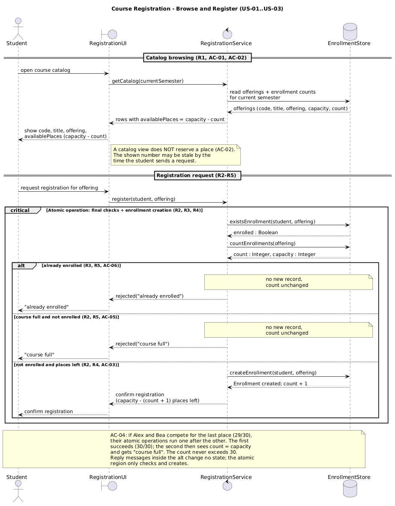
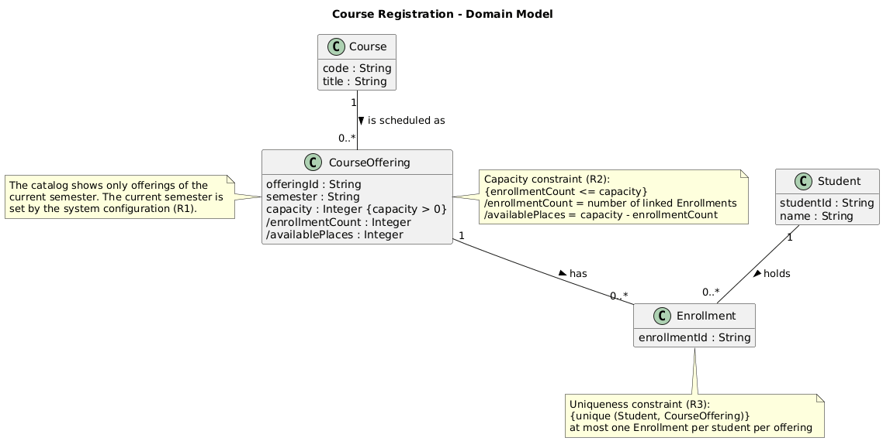
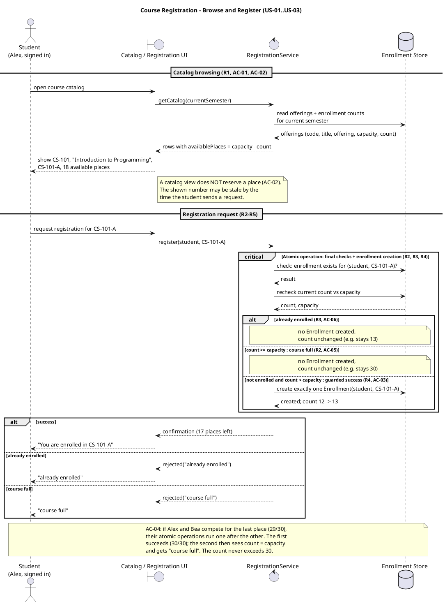
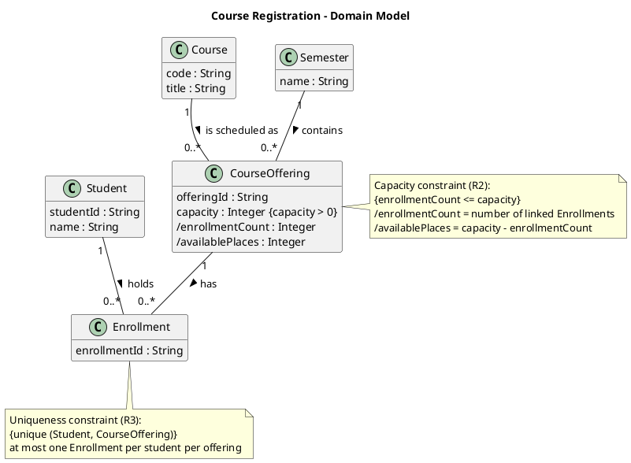
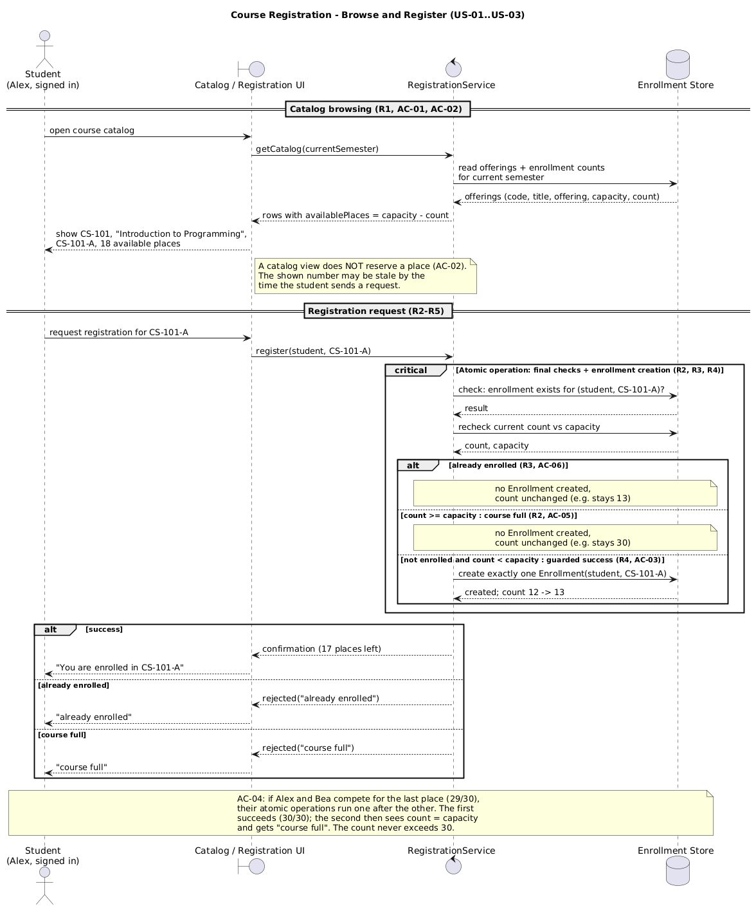
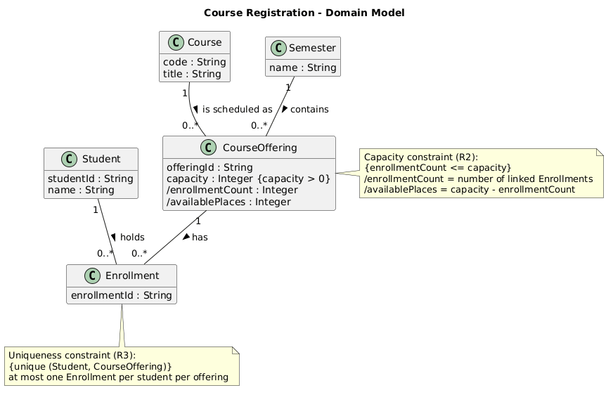

# SIS #02 — AI-Assisted UML Modeling: University Course Registration

<!--
  This is the only file you write your report in. README.md tells you what goes where.

  Rules the checker relies on:
  - Do not delete, rename or renumber the ## headings, the ### headings, or the **Label:** words.
  - Replace every "(write here)" and "(paste here)". None may be left when you submit.
  - Comments like this one are ignored by the checker and the word counter. Delete them or leave them.
-->

## 1. Scope and assumptions

<!-- Your FINAL scope statement and assumptions, after reviewing Prompt A's output. Say here
     what is out of scope (payments, prerequisites, timetable clashes, waiting lists,
     cancellation) — section 2 must not mention them. Section 10 keeps your first version. -->

**Scope:** The system lets a signed-in student browse the course catalog for the current semester, choose a course offering and register for it. The system accepts or rejects the request and explains why. Payments, prerequisites, timetable clashes, waiting lists and cancellation are out of scope.

**Assumptions:**

1. The catalog shows only the current semester.
2. Available places = capacity minus the number of enrollments in the offering.
3. A catalog view reserves nothing. The system checks the places again when the student registers.
4. The duplicate check, the capacity check and the creation of the Enrollment are one atomic step, so two requests can not take the same last place.
5. If a student is already enrolled and the offering is also full, the system answers "already enrolled", because the duplicate check comes first.
6. All students and courses are fictional.

## 2. User stories and acceptance criteria

<!-- Your APPROVED requirements: Prompt A's draft after your review. Keep the IDs, the three
     story headings and the bullet shape. Every criterion names the rule(s) it maps to,
     e.g. (R2, R4). Two criteria per story. Nothing out of scope.
     Format of a criterion, on one bullet:
     - **AC-03** (R2, R4): Given ..., When ..., Then ... -->

### US-01 — Browse offerings

**US-01:** As a signed-in student, I want to see the course offerings of the current semester with their available places, so that I can choose an offering to register for.

- **AC-01** (R1): Given offering CS-101-A of course CS-101 "Introduction to Programming" in the current semester has capacity 30 and 12 enrollments, When Alex opens the course catalog, Then the catalog shows the code CS-101, the title "Introduction to Programming", the offering CS-101-A and 18 available places, and only offerings of that semester.
- **AC-02** (R1, R2): Given the catalog showed Alex 1 available place in CS-101-A, When Bea registers for CS-101-A before Alex sends a request, Then no place is held for Alex, and when Alex then requests registration the system checks the places again at that moment.

### US-02 — Register for an offering

**US-02:** As a signed-in student, I want to request registration for an offering I chose, so that I am enrolled and get a confirmation.

- **AC-03** (R2, R3, R4): Given CS-101-A has capacity 30 and 12 enrollments and Alex has no enrollment in it, When Alex requests registration for CS-101-A, Then the system checks again, creates exactly one Enrollment linking Alex and CS-101-A, the count becomes 13 with 17 places left, and Alex gets a confirmation.
- **AC-04** (R2, R4, R5): Given CS-101-A has capacity 30 and 29 enrollments and neither Alex nor Bea is enrolled in it, When Alex and Bea request registration at the same time, Then exactly one of them gets an Enrollment and a confirmation, the other is rejected with "course full", and the count ends at 30, never more.

### US-03 — Receive a clear rejection

**US-03:** As a signed-in student, I want to be told why my registration request was rejected, so that I know I was not enrolled.

- **AC-05** (R2, R5): Given CS-101-A has capacity 30 and 30 enrollments and Chen has no enrollment in it, When Chen requests registration for CS-101-A, Then the request is rejected with "course full", no Enrollment is created and the count stays 30.
- **AC-06** (R3, R5): Given Alex already has an Enrollment in CS-101-A and it has 13 enrollments, When Alex requests registration for CS-101-A again, Then the request is rejected with "already enrolled", no new Enrollment is created and the count stays 13.

## 3. Sequence diagram

<!-- The FINAL diagram, rendered. Change .png to .svg if that is what you exported. -->



**Participants:** (write here — each lifeline and what it stands for)

**Atomic operation:** (write here — which messages form the one atomic step: the final duplicate check, the capacity check and the creation of the Enrollment, and why a catalog view reserves nothing)

**Where the Enrollment is created:** (write here — which message, which lifeline, and which class in section 4 it produces)

**Technical lifelines:** (write here — every lifeline that is NOT a class in the class diagram, by name, and why the difference in abstraction is fine. "None" if there are none.)

## 4. Class diagram

<!-- The FINAL diagram, rendered. -->



<!-- One row per association in classes.puml, read in both directions. -->

| Association | Read left to right | Read right to left |
| --- | --- | --- |
| (write here) | (write here) | (write here) |
| (write here) | (write here) | (write here) |
| (write here) | (write here) | (write here) |

**How an Enrollment links a student to an offering:** (write here)

**Capacity constraint:** (write here — and why multiplicity alone cannot express it)

**Uniqueness constraint:** (write here — and why multiplicity alone cannot express it)

## 5. Traceability

<!-- Every rule, including the catalog fields and availability (R1). Column 1: the rule and
     the criteria that cover it, e.g. "R2 + AC-03, AC-04". Column 2: the message, guard,
     class or constraint that shows the rule in YOUR diagrams. Column 3: the T-ID that
     exercises it, or the extra check you did instead (R1 has no T case). -->

| Rule and criterion | Model evidence | Validation case |
| --- | --- | --- |
| R1 + (write here) | (write here) | (write here) |
| R2 + (write here) | (write here) | (write here) |
| R3 + (write here) | (write here) | (write here) |
| R4 + (write here) | (write here) | (write here) |
| R5 + (write here) | (write here) | (write here) |

## 6. Walkthroughs

<!-- Walk each case through YOUR final sequence diagram, message by message. Column 2: the
     actual steps and the state change (count before → after). Column 3 starts with Pass or
     Fail, then the location: the message, guard or note where you saw it. A Fail you
     report honestly is a finding, not a penalty. -->

| Case | Observed path and state change | Judgment and evidence |
| --- | --- | --- |
| T1. Available | (write here) | (write here) |
| T2. Last place | (write here) | (write here) |
| T3. Full | (write here) | (write here) |
| T4. Duplicate | (write here) | (write here) |

## 7. Review decisions

<!-- At least three substantive decisions about Prompt C's critique or your own inspection.
     Decision: accepted / rejected / modified — and what you did. Reason: why, in a full
     sentence. Rule: R1–R5. Do not invent an error to fill the table; a justified rejection
     of advice counts. -->

| AI suggestion or model element | Decision | Reason | Rule |
| --- | --- | --- | --- |
| (write here) | (write here) | (write here) | (write here) |
| (write here) | (write here) | (write here) | (write here) |
| (write here) | (write here) | (write here) | (write here) |

## 8. Modeling explanation

<!-- 200–300 words. Your main design choices; how the class diagram and the sequence diagram
     complement each other; why an activity diagram could also help explain the workflow. -->

(write here)

## 9. Reflection

<!-- 150–200 words. Written by you, not by the assistant: where AI helped, one decision you
     made yourself, one remaining limitation. Specific beats flattering. -->

(write here)

## 10. Appendix A — Before AI

<!-- Written BEFORE you run Prompt A, committed and pushed in your first commit, and never
     edited afterwards. This is what you paste into Prompt A as "My initial assumptions". -->

**Scope:** The system lets a signed-in student browse the course catalog for one semester, choose a course offering and register for it. The system accepts or rejects the request and explains why. Payments, prerequisites, timetable clashes, waiting lists and cancellation are out of scope.

**Initial assumptions:**

1. The catalog shows the free places at the moment the student looks. This number can change before the student sends the request, so the system checks the places again when the student registers.
2. If two students ask for the last place at the same time, only one of them gets it. The checks and the creation of the enrollment happen as one step.
3. The catalog shows only one semester, the current one.
4. All students and courses in this work are fictional.

## 11. Appendix B — AI exchanges

<!-- Complete prompts and complete responses, as text — never screenshots. Paste each inside
     the ~~~~ block that follows its label: AI responses contain ``` PlantUML blocks, and
     ~~~~ keeps them from breaking this file. Prompts B and C: the prompt text first, then
     the material it refers to ("below", "these two") pasted under it, in the same block.
     You may add B5, B6 … after B4 if you ran more. -->

### B1 — Requirements (Prompt A)

- **Tool:** Claude (Claude Code)
- **Model:** Claude Opus 5.5
- **Date:** 2026-10-07
- **Purpose:** draft 3 user stories and 6 acceptance criteria

<!-- Model: the exact model with its version, as the tool shows it (e.g. "GPT-5 Thinking",
     "Claude Sonnet 4.5"). If the tool does not show it, write: not displayed
     Date: YYYY-MM-DD -->

**Prompt:**

~~~~text
Act as a requirements analyst. Use only this course registration scenario and rules R1–R5: A student browses an electronic course catalog, chooses a course offering and requests registration. Each offering has a limited number of places. A Course describes a subject. A CourseOffering is one scheduled section in one semester. Registration always targets a specific offering. Assume that the student is signed in, the selected offering exists, and its capacity is a positive whole number. Exclude payments, prerequisites, timetable clashes, waiting lists and cancellation. Use fictional students and courses. R1. Catalog: Show the course code, title, offering and available places for one semester. R2. Capacity: Recheck current availability when registering. Enrollment must never exceed the offering's capacity. R3. Duplicates: A student may have at most one enrollment in the same offering. Reject a repeat request. R4. Success: Create exactly one Enrollment linking the student and offering, update availability and return a confirmation. R5. Rejection: Explain "course full" or "already enrolled". Create no enrollment and leave the enrollment count unchanged. A catalog view does not reserve a place. Model the final checks and enrollment creation as one atomic operation so competing requests cannot take the same last place. My initial assumptions are 1. The catalog shows the free places at the moment the student looks. This number can change before the student sends the request, so the system checks the places again when the student registers. 2. If two students ask for the last place at the same time, only one of them gets it. The checks and the creation of the enrollment happen as one step. 3. The catalog shows only one semester, the current one. 4. All students and courses in this work are fictional.
Draft 3 user stories and 2 Given / When / Then acceptance criteria for each. Use IDs US-01 to US-03 and AC-01 to AC-06. Map each criterion to rule IDs.
Cover normal and rejection behavior. List uncertainty separately. Do not add excluded features or invent university policies.
~~~~

**Response:**

~~~~text
Here are three user stories with two acceptance criteria each. All data is fictional. The example offering is CS-101-A, a section of the course CS-101 "Introduction to Programming", in the current semester. It has a capacity of 30.

---

## User Stories and Acceptance Criteria

### US-01: Browse the course catalog
**As a** signed-in student, **I want to** see the course offerings for the semester with their available places, **so that** I can choose an offering to register for.

**AC-01: Catalog shows the required information** *(R1)*
- **Given** student Alex Rivera is signed in
- **And** offering CS-101-A of course CS-101 "Introduction to Programming" in the current semester has capacity 30 and 12 enrollments
- **When** Alex opens the course catalog
- **Then** the catalog shows the course code "CS-101", the title "Introduction to Programming", the offering "CS-101-A" and 18 available places
- **And** it shows only offerings from that one semester

**AC-02: Viewing the catalog does not reserve a place** *(R1, R2)*
- **Given** Alex is viewing the catalog and CS-101-A shows 1 available place
- **When** student Bea Okafor registers for CS-101-A before Alex sends a request
- **Then** Bea's registration succeeds and Alex gets no reserved or held place
- **And** if Alex then requests registration, the system checks availability again at that moment rather than using the number Alex saw

---

### US-02: Register for an offering with free places
**As a** signed-in student, **I want to** request registration for an offering I chose, **so that** I am enrolled and get a confirmation.

**AC-03: Successful registration** *(R2, R4)*
- **Given** CS-101-A has capacity 30 and 12 enrollments
- **And** Alex has no enrollment in CS-101-A
- **When** Alex requests registration for CS-101-A
- **Then** exactly one Enrollment linking Alex and CS-101-A is created
- **And** CS-101-A now has 13 enrollments and shows 17 available places
- **And** Alex gets a confirmation

**AC-04: Two requests for the last place** *(R2, R4, R5)*
- **Given** CS-101-A has capacity 30 and 29 enrollments
- **And** neither Alex nor Bea is enrolled in CS-101-A
- **When** Alex and Bea request registration for CS-101-A at the same time
- **Then** exactly one of them gets an Enrollment and a confirmation
- **And** the other is rejected with "course full", and no Enrollment is created for them
- **And** CS-101-A ends with exactly 30 enrollments, never more

---

### US-03: Be told clearly why a registration was rejected
**As a** signed-in student, **I want to** be told why my registration request was rejected, **so that** I understand that I was not enrolled.

**AC-05: Rejected because the course is full** *(R2, R5)*
- **Given** CS-101-A has capacity 30 and 30 enrollments
- **And** Chen Larsen has no enrollment in CS-101-A
- **When** Chen requests registration for CS-101-A
- **Then** the request is rejected with the explanation "course full"
- **And** no Enrollment is created
- **And** CS-101-A still has 30 enrollments

**AC-06: Rejected because the student is already enrolled** *(R3, R5)*
- **Given** Alex already has an Enrollment in CS-101-A
- **And** CS-101-A has capacity 30 and 13 enrollments
- **When** Alex requests registration for CS-101-A again
- **Then** the request is rejected with the explanation "already enrolled"
- **And** no new Enrollment is created
- **And** CS-101-A still has 13 enrollments

---

## Rule Coverage

| Rule | Covered by |
|---|---|
| R1 Catalog | AC-01, AC-02 |
| R2 Capacity | AC-02, AC-03, AC-04, AC-05 |
| R3 Duplicates | AC-06 |
| R4 Success | AC-03, AC-04 |
| R5 Rejection | AC-04, AC-05, AC-06 |

Normal behavior is covered by AC-01 and AC-03. Rejections and edge cases are covered by AC-02, AC-04, AC-05 and AC-06.

---

## Uncertainties (open questions, not decided here)

1. **Which semester.** R1 says "one semester". Showing only the current one is your assumption 3, not a rule. Who decides which semester is shown?
2. **What "offering" means on screen.** R1 asks for the offering to be shown, but not which details: a section ID, a schedule, or something else.
3. **Both reasons at once.** If an offering is full and the student is already enrolled in it, which message is shown? The rules don't set an order.
4. **Duplicate requests sent together.** If one student sends two requests for the same offering at the same moment (for example, a double-click), is the duplicate check part of the same single step as the capacity check? The atomic-step note suggests yes, but it isn't stated directly.
5. **What the confirmation contains.** R4 asks for a confirmation but doesn't say what is in it or how it is delivered.
6. **Exact wording of the messages.** R5 gives "course full" and "already enrolled". Are these the exact texts, or only what the message must mean?
7. **How available places are worked out.** I assumed available places = capacity − number of enrollments. The rules imply this but never define it.
8. **Catalog refresh.** Should the catalog update by itself when availability changes, or only when the student reloads it? R1 doesn't say.
9. **Other sections of the same course.** R3 limits a student to one enrollment per offering. The rules don't say whether a student may enroll in two different offerings of the same course. I added no rule for this.
10. **Capacity changes.** The rules don't cover what happens if an offering's capacity changes after students have enrolled.
11. **Meaning of "at the same time".** Assumption 2 says only one student gets the last place. The rules don't say how the winner is chosen, for example the first request to arrive.

Your assumptions 1 and 2 match R2 and the note about the single atomic step. Assumption 4 is followed throughout. Nothing excluded (payments, prerequisites, timetable clashes, waiting lists, cancellation) has been added.
~~~~

### B2 — UML drafts (Prompt B)

- **Tool:** Claude (Claude Code)
- **Model:** Claude Opus 5.5
- **Date:** 2026-10-07
- **Purpose:** draft the sequence and class diagrams

**Prompt:**

~~~~text
Using my approved scenario, R1–R5, stories and criteria below, return separate PlantUML code blocks for a sequence diagram and a domain class diagram.
Sequence: include catalog browsing and guarded success, full-course and duplicate outcomes. Model final checks and creation as one atomic operation.
Class: show domain concepts, useful attributes and multiplicities. State the capacity and uniqueness constraints. Explain assumptions and any technical lifelines.

### US-01 — Browse offerings

**US-01:** As a signed-in student, I want to see the course offerings of the current semester with their available places, so that I can choose an offering to register for.

- **AC-01** (R1): Given offering CS-101-A of course CS-101 "Introduction to Programming" in the current semester has capacity 30 and 12 enrollments, When Alex opens the course catalog, Then the catalog shows the code CS-101, the title "Introduction to Programming", the offering CS-101-A and 18 available places, and only offerings of that semester.
- **AC-02** (R1, R2): Given the catalog showed Alex 1 available place in CS-101-A, When Bea registers for CS-101-A before Alex sends a request, Then no place is held for Alex, and when Alex then requests registration the system checks the places again at that moment.

### US-02 — Register for an offering

**US-02:** As a signed-in student, I want to request registration for an offering I chose, so that I am enrolled and get a confirmation.

- **AC-03** (R2, R3, R4): Given CS-101-A has capacity 30 and 12 enrollments and Alex has no enrollment in it, When Alex requests registration for CS-101-A, Then the system checks again, creates exactly one Enrollment linking Alex and CS-101-A, the count becomes 13 with 17 places left, and Alex gets a confirmation.
- **AC-04** (R2, R4, R5): Given CS-101-A has capacity 30 and 29 enrollments and neither Alex nor Bea is enrolled in it, When Alex and Bea request registration at the same time, Then exactly one of them gets an Enrollment and a confirmation, the other is rejected with "course full", and the count ends at 30, never more.

### US-03 — Receive a clear rejection

**US-03:** As a signed-in student, I want to be told why my registration request was rejected, so that I know I was not enrolled.

- **AC-05** (R2, R5): Given CS-101-A has capacity 30 and 30 enrollments and Chen has no enrollment in it, When Chen requests registration for CS-101-A, Then the request is rejected with "course full", no Enrollment is created and the count stays 30.
- **AC-06** (R3, R5): Given Alex already has an Enrollment in CS-101-A and it has 13 enrollments, When Alex requests registration for CS-101-A again, Then the request is rejected with "already enrolled", no new Enrollment is created and the count stays 13.
~~~~

**Response:**

~~~~text
Here are the two diagrams, built only from your approved scenario, R1–R5, US-01 to US-03 and AC-01 to AC-06. Students and courses are fictional. I have not rendered either diagram, so the code has not been checked in a PlantUML viewer yet.

## 1. Sequence diagram



## 2. Domain class diagram



## Constraints

- **Capacity (R2):** For every CourseOffering, `enrollmentCount <= capacity`, and `capacity` is a positive whole number (scenario assumption). The constraint is enforced by rechecking inside the atomic operation, not by the number shown in the catalog.
- **Uniqueness (R3):** For any pair of Student and CourseOffering, there is at most one Enrollment.
- **Exactly one (R4):** A successful request creates exactly one Enrollment, linked to exactly one Student and one CourseOffering. That is why the Enrollment end of each association is "1".

## Assumptions

1. **Order of checks.** Inside the atomic operation, the duplicate check runs before the capacity check. So if an offering is full and the student is already enrolled, they see "already enrolled". The rules don't set this order; it was left open earlier and is still a design choice for you to confirm.
2. **Derived values.** The enrollment count and available places are worked out from the Enrollments, not stored separately. That is what the "/" prefix means.
3. **Semester.** The Semester class only lets the catalog filter to one semester (R1, current semester per your assumption 3). It has no other policy.
4. **Excluded features.** Nothing for payments, prerequisites, timetable clashes, waiting lists or cancellation appears in either diagram.
5. **Simple attributes.** IDs and names are kept minimal. The confirmation is a return message, not a stored class, because R4 doesn't say it is kept.
6. **Concurrency.** The diagram shows a single request path. The AC-04 race is explained in a note: the atomic operation lets competing requests through one at a time.

## Technical lifelines

These are design aids, not domain concepts.

- **Catalog / Registration UI (boundary):** where the student interacts and where the results and messages are shown.
- **RegistrationService (control):** owns the rules and the atomic step that checks and then creates the enrollment.
- **Enrollment Store (database):** where offerings and enrollments are kept. In a real system, the atomic step would be a database transaction with suitable locking or a unique-key constraint. That is an implementation assumption, not part of the rules.
~~~~

### B3 — Model critique (Prompt C)

- **Tool:** (write here)
- **Model:** (write here)
- **Date:** (write here)
- **Purpose:** review both models against R1–R5 and T1–T4

**Prompt:**

~~~~text
(paste here)
~~~~

**Response:**

~~~~text
(paste here)
~~~~

### B4 — Focused revision (Prompt D)

- **Tool:** (write here)
- **Model:** (write here)
- **Date:** (write here)
- **Purpose:** apply my accepted review decisions

**Prompt:**

~~~~text
(paste here)
~~~~

**Response:**

~~~~text
(paste here)
~~~~

## 12. Appendix C — Original diagrams

<!-- The AI's first output from Prompt B, rendered unedited from models/original/. -->





## 13. Appendix D — References and source checks

### References

<!-- Full references, one per line, each starting with "- ". Only sources you actually opened.
     Every URL used in the source checks must also appear here. Example:
     - Sommerville, I. (2016). Software Engineering, 10th ed., Global Edition. Pearson. Ch. 5. -->

- (write here)

### Source checks

<!-- At least two modeling decisions you verified. Source and locator: title + slide, page,
     section, chapter or figure — or title + URL + access date (YYYY-MM-DD). Slide numbers
     refer to the decks posted in our Teams. -->

| Modeling decision | Source and locator | What the source says | How it supports or changed your model |
| --- | --- | --- | --- |
| (write here) | (write here) | (write here) | (write here) |
| (write here) | (write here) | (write here) | (write here) |
